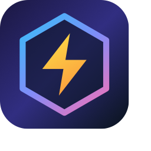

<p align="center">
  
</p>

<h1 align="center">Bunest</h1>

<p align="center">
  <strong>NestJS architecture, built natively on <a href="https://bun.sh" target="_blank">Bun</a>.</strong><br />
  Zero external runtime dependencies · 100% NestJS v12 conformance (7,005/7,005) · Near-raw <code>Bun.serve</code> speed · AI-first DX.
</p>

<p align="center">
  <a href="https://github.com/nctuanit/bunest/actions/workflows/ci.yml"></a>
  <a href="https://nctuanit.github.io/bunest/"></a>
  <a href="./tests/nestjs-conformance/CONFORMANCE_REPORT.md"></a>
  <a href="https://bun.sh">= 1.4.5" /></a>
  <a href="./docs/adr/ADR-017.md"></a>
  <a href="./LICENSE"></a>
</p>

<p align="center">
  <a href="https://codespaces.new/nctuanit/bunest"></a>
</p>

---

## Why Bunest?

If you love NestJS's modular architecture (`@Module`, `@Controller`, DI, Guards, Pipes, Interceptors, Exception Filters, `TestingModule`) but want native **Bun** performance without Express, Fastify, RxJS, or bloated `node_modules`:

| Metric | Bunest (`0.1.0`) | Evidence |
| --- | --- | --- |
| **External runtime dependencies** | **0** across all **19 packages** | Built on `Bun.serve`, `Bun.SQL`, `bun:sqlite`, `Bun.RedisClient`, `Bun.password`, WebCrypto ([ADR-017](./docs/adr/ADR-017.md)) |
| **NestJS v12 Conformance** | **7,005 / 7,005 (100%, 0 skip)** | [Conformance Report](./tests/nestjs-conformance/CONFORMANCE_REPORT.md) |
| **Param GET `/users/:id` + DI** | **151,968 req/s** (`95.6%` of raw `Bun.serve`, `0.165 ms` p50) | [Benchmarks](./benchmarks/RESULTS.md) (Apple M4, Bun 1.4.5) |
| **Validated POST (DTO)** | **93,508 req/s** (`97.9%` of raw `Bun.serve`) | [Benchmarks](./benchmarks/RESULTS.md) |
| **Cold Bootstrap / Hot Singleton DI** | **0.11 ms** p50 / **5.26M ops/s** | [Benchmarks](./benchmarks/RESULTS.md) |
| **Async Model** | Native `Promise<T>` (no RxJS) | Zero observable wrapper overhead |

---

## Quick Start

```bash
bunx @bunest/cli new my-api
cd my-api
bun run dev
```

Or in a single file:

```ts
import { BunestFactory, Controller, Get, Module, Param } from "@bunest/core";

@Controller("/hello")
class AppController {
  @Get(":name")
  greet(@Param("name") name: string) {
    return { message: `Hello, ${name}!` };
  }
}

@Module({ controllers: [AppController] })
class AppModule {}

const app = await BunestFactory.create(AppModule);
await app.listen(3000);
```

### Familiar to Every NestJS Developer

```diff
- import { Controller, Get, Param, Module } from "@nestjs/common";
- import { NestFactory } from "@nestjs/core";
+ import { BunestFactory, Controller, Get, Module, Param } from "@bunest/core";
```

See the full [NestJS Migration Guide](./docs/nestjs-migration.md) for side-by-side patterns.

---

## AI-First Developer Experience

Bunest is engineered to work seamlessly with AI coding agents (Cursor, Claude Code, Antigravity, Codex):

- **Machine-readable docs**: Auto-generated [`llms.txt`](./llms.txt), [`llms-full.txt`](./llms-full.txt), and [`docs/errors.md`](./docs/errors.md) verified fresh in CI (`bun run ai:docs --check`).
- **Built-in MCP Server**: Run `bunest mcp` to expose live workspace routes, DI graph, entities, and error diagnostics directly to your AI IDE.
- **Stable Error Catalog (`BUNEST_E*`)**: Every bootstrap/routing failure carries a stable code with ordered fix steps.
- **Compact Agent Verifier**: `bunest verify --reporter=agent` runs typecheck + tests in one shot with token-efficient diagnostics.

---

## Packages

19 zero-dependency workspace packages organized across 6 domains:

| Domain | Packages |
| --- | --- |
| **Core & Validation** | [`@bunest/core`](./packages/core), [`@bunest/validation`](./packages/validation) |
| **Security** | [`@bunest/security`](./packages/security) |
| **API & AI** | [`@bunest/swagger`](./packages/swagger), [`@bunest/graphql`](./packages/graphql), [`@bunest/ai`](./packages/ai) |
| **Data & Integrations** | [`@bunest/orm`](./packages/orm), [`@bunest/cache`](./packages/cache), [`@bunest/storage`](./packages/storage), [`@bunest/mail`](./packages/mail), [`@bunest/elasticsearch`](./packages/elasticsearch) |
| **Distributed & Async** | [`@bunest/messaging`](./packages/messaging), [`@bunest/jobs`](./packages/jobs), [`@bunest/resilience`](./packages/resilience), [`@bunest/microservices`](./packages/microservices), [`@bunest/workflows`](./packages/workflows) |
| **DX & Ops** | [`@bunest/observability`](./packages/observability), [`@bunest/testing`](./packages/testing), [`@bunest/cli`](./packages/cli) |

---

## VS Code Extension

First-class IDE support for VS Code, Cursor, and Antigravity IDE ([`apps/vscode-bunest`](./apps/vscode-bunest)) with live zero-save typegen, declarative repository autocomplete & SQL preview, Route Explain & quick fixes, HTTP Studio (with Save as Test), Live Inspector, static diagnostics, and an interactive DI graph.

Download the latest `.vsix` from **[GitHub Releases](https://github.com/nctuanit/bunest/releases)**:

```bash
code --install-extension vscode-bunest-<version>.vsix
```

---

## Documentation & Production Runbooks

Full bilingual (English / Vietnamese) guides, API references, and examples are available at **[nctuanit.github.io/bunest](https://nctuanit.github.io/bunest/)**:

- [Quickstart Guide](./docs/quickstart.md) — Build, document, and test a REST CRUD API
- [Production Preview Runbook](./docs/production-preview.md) · [Support & Versioning Policy](./docs/support-policy.md)
- [Architecture & ADRs](./docs/architecture.md) · [ADR Index](./docs/adr/README.md)
- [NestJS Migration Guide](./docs/nestjs-migration.md) · [NestJS v12 Conformance Report](./tests/nestjs-conformance/CONFORMANCE_REPORT.md)
- [Security Guide](./docs/security.md) · [Testing Guide](./docs/testing.md) · [Benchmarks](./benchmarks/RESULTS.md)
- [Error Catalog](./docs/errors.md) · AI Docs: [`llms.txt`](./llms.txt) / [`llms-full.txt`](./llms-full.txt)

## Examples

- **Production Reference**: [`examples/production-rest-postgres`](./examples/production-rest-postgres) (PostgreSQL 17, Docker, Caddy, migrations, `/live` & `/ready`, graceful drain, zero-downtime rollback, load harness)
- **Starter & Feature Examples**: [`examples/hello-world`](./examples/hello-world) · [`examples/rest-crud`](./examples/rest-crud) · [`examples/auth-jwt-sqlite`](./examples/auth-jwt-sqlite) · [`examples/websocket-chat`](./examples/websocket-chat) · [`examples/distributed-worker`](./examples/distributed-worker) · [`apps/playground`](./apps/playground)

## Development

```bash
bun install                                 # Install workspace packages
bun run typecheck                           # Typecheck (bun check)
bun run build                               # Clean & build all packages, docs & VS Code extension
bun test                                    # Run full test suite
bun run conformance:gate                    # Verify 100% NestJS conformance ratchet
bun run verify:release                      # Verify zero-dep, quarantine & CLI smoke gates
bun run --cwd apps/vscode-bunest package    # Package VS Code extension (.vsix)
```

## Community & License

- [GitHub Discussions](https://github.com/nctuanit/bunest/discussions) — Questions, ideas, and Show & Tell
- [Contributing Guide](./CONTRIBUTING.md) · [Code of Conduct](./CODE_OF_CONDUCT.md) · [Security Policy](./SECURITY.md) · [Changelog](./CHANGELOG.md)
- Bunest is [MIT licensed](./LICENSE).
