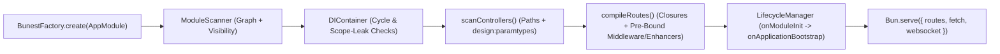

# Bunest Architecture

Bunest combines NestJS-style modular architecture with a **compile-at-bootstrap, zero-hot-path-reflection** execution engine built directly on Bun's native HTTP, WebSocket, SQL, and `AsyncLocalStorage` primitives.

For the full normative contract behind every design choice, see [RFC-001](./rfcs/RFC-001-controller-routing.md) and [ADR-001 through ADR-012](./adr/README.md).

---

## 1. Monorepo Package Dependency DAG

All 20 workspace packages form a strict Directed Acyclic Graph (DAG) with zero runtime circular dependencies between packages:

```mermaid
flowchart TD
  common["@bunest/common"]
  http["@bunest/http"]
  validation["@bunest/validation"]
  core["@bunest/core"]
  testing["@bunest/testing"]
  cli["@bunest/cli"]

  config["@bunest/config"]
  swagger["@bunest/swagger"]
  security["@bunest/security"]
  sqlite["@bunest/sqlite"]
  sql["@bunest/sql"]

  events["@bunest/events"]
  scheduler["@bunest/scheduler"]
  cache["@bunest/cache"]
  websockets["@bunest/websockets"]
  queues["@bunest/queues"]
  cqrs["@bunest/cqrs"]
  microservices["@bunest/microservices"]
  observability["@bunest/observability"]
  graphql["@bunest/graphql"]

  http --> common
  validation --> common
  cli --> common
  core --> common
  core --> http
  core --> validation

  testing --> common
  testing --> core
  testing --> http

  config --> common
  config --> core
  config --> validation

  swagger --> common
  swagger --> core
  swagger --> http

  security --> common
  security --> core
  security --> http

  sqlite --> common
  sqlite --> core
  sql --> common
  sql --> core

  events --> common
  events --> core
  scheduler --> common
  scheduler --> core
  queues --> common
  queues --> core
  cqrs --> common
  cqrs --> core
  microservices --> common
  microservices --> core

  cache --> common
  cache --> core
  cache --> http
  websockets --> common
  websockets --> core
  websockets --> http
  observability --> common
  observability --> core
  observability --> http
  graphql --> common
  graphql --> core
  graphql --> http
```



- **`@bunest/common`** is the zero-internal-dependency leaf package holding metadata symbols (`MetadataRegistry`, `Reflector`), legacy decorators, built-in pipes, `HttpException` hierarchy, `Logger`, and shared interfaces.
- **`@bunest/core`** re-exports `@bunest/common`, `@bunest/http` public adapters, and `@bunest/validation` (`ValidationPipe`, `ClassSerializerInterceptor`, `SchemaValidationPipe`) so typical applications import everything from `@bunest/core`.

---

## 2. Compile-at-Bootstrap Execution Model

Reflection (`Reflect.getMetadata`), module graph scanning, DI wiring, path normalization, enhancer resolution, and parameter-extractor compilation all run **once during bootstrap**—never on the per-request hot path:



Key bootstrap guarantees:
1. **Zero hot-path `Reflect.getMetadata()`:** Parameter extractors (`compileParameters`), enhancer chains, response metadata (`@HttpCode`, `@Header`, `@Redirect`, `@Sse`), and matching middleware lists are baked into immutable `CompiledRoute` closures before `Bun.serve()` starts.
2. **Fail-fast validation before binding a port:** Missing dependencies (`UnknownDependencyException`), invalid exports (`InvalidExportException`), ambiguous imports (`AmbiguousProviderException`), circular chains (`CircularDependencyException`), scope leaks (`ScopeLeakException`), undecorated controllers (`InvalidControllerException`), duplicate parameter decorators, and canonical route collisions (`DuplicateRouteException`, e.g., `GET /users/:id` vs `GET /users/:userId`) all throw before any listening socket opens.

---

## 3. Exact 11-Stage HTTP Execution Pipeline ([ADR-008](./adr/ADR-008.md))

Every matched HTTP request flows through the exact deterministic sequence below:

```text
Incoming Request
  1. Route Match (Bun.serve native routes OR FallbackRadixRouter -> 404/405)
  2. RequestContext Init (+ AsyncLocalStorage / RequestContainer when scoped)
  ── Exception Filter Boundary begins ──────────────────────────────────────────
  3. Security / CORS Pre-Processing (preflight short-circuit, bodyLimit, trustProxy IP)
  4. Middleware (Global -> Module-bound matching path/method)
  5. Guards (Global -> Controller -> Method)
  6. Interceptors [Before] (Global -> Controller -> Method)   ──┐
  7. Parameter Extraction (ascending ParameterMetadata.index)  │ Promise Onion
  8. Pipes & Validation (Global -> Controller -> Method -> Param)  CallHandler
  9. Controller Handler (await controller[handlerKey](...args))│ .handle()
 10. Interceptors [After] (Method -> Controller -> Global)    ──┘
 11. Response Serialization (ADR-010 + CORS/cookies/headers merge)
  ── Exception Filter Boundary catches throws from stages 3–11 (and 404/405) ──
  -> Exception Filters (Method -> Controller -> Global -> DefaultExceptionFilter)
  -> Native Web Response (CORS headers preserved on errors)
```

### Enhancer Precedence Rules

| Enhancer | Execution Order | Semantics |
|---|---|---|
| **Middleware** | `Global -> Module` (topological, registration order) | Returning `Response` or throwing short-circuits downstream |
| **Guards** | `Global -> Controller -> Method` | Runs before body parsing/pipes; `false` -> `403 ForbiddenException` |
| **Interceptors** | Before: `Global -> Controller -> Method` / After: `Method -> Controller -> Global` | Async `Promise` onion (`CallHandler.handle(): Promise<T>`) |
| **Pipes** | `Global -> Controller -> Method -> Parameter` | Chained per parameter in ascending index order |
| **Exception Filters** | `Method -> Controller -> Global -> DefaultExceptionFilter` | **Most-specific first**; first `@Catch(...)` match wins |

---

## 4. Hybrid Native `Bun.serve({ routes })` + Fallback Router ([ADR-011](./adr/ADR-011.md))

Bunest exploits Bun's native Zig radix router while cleanly covering HTTP features Bun's native `routes` map does not handle on its own:

- **Native Fast Path (`Bun.serve({ routes })`):**
  - Eligible paths (static `/users`, named params `/users/:id`, trailing catch-all `/files/*`, with no `host` constraint) are grouped by normalized path and registered as a **single per-path compiled dispatcher closure** in `routes[path]`.
  - Why a per-path closure instead of `{ GET, POST }`? Because Bun's `{ GET, POST }` drops unmatched methods into `fetch()` with no `Allow` header. A single per-path closure keeps Bun's native radix matching (`static > :param > * > fetch`), `req.params`, and `req.cookies`, while delivering:
    - **O(1)** method table lookup (`HEAD` falls back to `GET` with empty body; `@All()` serves as per-path fallback)
    - Instant **`405 Method Not Allowed` + sorted `Allow` header** without re-matching the URL
    - Per-path **CORS preflight `OPTIONS`**
    - **Pre-bound global + module middleware** (zero runtime middleware path scanning)
- **Controlled Fallback (`fetch(req, server)`):**
  1. WebSocket upgrades (`server.upgrade(req, ...)`) registered on non-`routes` paths
  2. Optional trailing-slash normalization (when `ignoreTrailingSlash: true`)
  3. **`FallbackRadixRouter`** for advanced routes not supported by Bun's native router: `@Controller({ host })`, mid-path wildcards (`/files/*/meta`), optional params (`/users/:id?`), and regex-constrained params (`/users/:id(\d+)`)
  4. Unmatched CORS preflight `OPTIONS`
  5. **`404 Not Found`** routed through Global Exception Filters with CORS headers preserved

Both native and fallback paths invoke the exact same `executeCompiledRoute()` pipeline, guaranteeing identical runtime semantics.

---

## 5. Module Visibility, DI Scopes & `AsyncLocalStorage` ([ADR-007](./adr/ADR-007.md), [ADR-012](./adr/ADR-012.md))

### Module Encapsulation

- Providers declared in `M.providers` are **private** to module `M` unless listed in `M.exports`.
- Re-exporting an imported module exposes its exports transitively; exporting an unimported module or undeclared token fails fast (`InvalidExportException`).
- Token lookup order inside `M`: **1. Local `providers`** -> **2. Direct `imports` exports** (collision fails fast with `AmbiguousProviderException`) -> **3. `@Global()` exports** (collision fails fast).
- Static modules deduplicate by class reference across the graph; `DynamicModule` objects isolate distinct registrations while deduplicating shared object references.

### DI Scopes & Fail-Fast Scope-Leak Detection

| Scope | Lifetime | Propagation |
|---|---|---|
| `Scope.SINGLETON` *(default)* | App lifetime (eager at bootstrap) | Zero per-request allocation |
| `Scope.TRANSIENT` | New instance per injection point | Bound at bootstrap (for singletons) or per request (for request-scoped consumers) |
| `Scope.REQUEST` | Single HTTP request (lazy per request) | Isolated `RequestContainer` inside `AsyncLocalStorage<RequestContext>` (`node:async_hooks`) |

- **Zero-overhead singleton fast path:** `compileRoutes()` statically computes `requiresRequestScope` per route. Pure-singleton routes skip `RequestContainer` allocation completely.
- **No silent scope bubbling:** If any `Scope.SINGLETON` provider, controller, or enhancer depends (directly or transitively) on a `Scope.REQUEST` provider, bootstrap throws `ScopeLeakException` printing the exact dependency chain.
- **Guaranteed teardown:** `RequestContainer.destroy()` runs `onRequestDestroy()` / `Symbol.asyncDispose` in a `finally` block on completion, error, or client abort.
