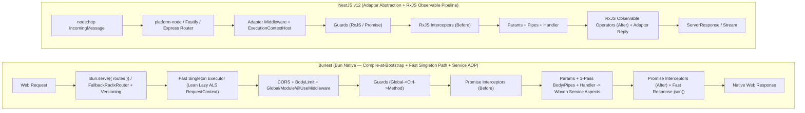

# So sánh Toàn diện: Bunest vs NestJS

> **Tài liệu kỹ thuật đối chiếu dựa trên bằng chứng mã nguồn & đo đạc thực nghiệm**
>
> - **Bunest:** `v0.1.0` + **2 cột mốc lớn hoàn tất (`Unreleased / 0.2.0`)**:
>   1. **Hệ sinh thái 35 Packages Thống nhất Bun-native tương đương NestJS v12** (18 core/eco packages + 17 Tier-1 & Tier-2 packages bao gồm **`@bunest/orm`** thống nhất 12 dialect + SQL Store Kit subpaths = **35 workspace packages**, Bun `v1.4.3`, TypeScript `^7.0.2`) — loại bỏ toàn bộ facade/wrapper thừa (**0 cycles**, **29/35 packages có 0 external runtime dep**, **0 RxJS**).
>   2. **Kiến trúc Service-Layer AOP Method Aspect & Declarative Decorators ([ADR-014](./adr/ADR-014.md)):** `createMethodAspectDecorator`, `DIContainer` `MethodAspectWeaver` không chi phí trên class thường, `@UseMiddleware`, `@Transactional`, Spring Data-style `@OrmRepository` + `CrudRepository` + `@Query`/`@Modifying`/`@SqlParam` + derived finders biên dịch 1 lần trong `@bunest/orm`, `@Cacheable`/`@CacheEvict`/`@CachePut`, `@Span`/`@Trace`/`@Timed`/`@Counted`, `@EmitEvent`/`@EventPayload`, `@Auth`/`@Protected`/`SecurityModule.forRoot`, `@InjectConfig`/`@ConfigValue`, `@WithLock`, `@WithCls`, và `@Retry`/`@CircuitBreaker`/`@Timeout`/`@Bulkhead`/`@Fallback` ở tầng service.
> - **NestJS:** `v12.5.1` (ESM, `latest`) & `v11.2.11` (CJS, `legacy`) từ nguồn gốc [`github.com/nestjs/nest`](https://github.com/nestjs/nest) và npm registry (snapshot ngày `2026-11-20`).
> - **Benchmark đối đầu trực tiếp:** 8 target chạy trong child process cô lập hoàn toàn, tổng **384,000 request HTTP đo đạc (`0.00%` lỗi)** — xem toàn bộ số liệu gốc tại [`benchmarks/nestjs-comparison/RESULTS.md`](../benchmarks/nestjs-comparison/RESULTS.md) và benchmark hậu tích hợp 53 packages + AOP tại [`benchmarks/RESULTS.md`](../benchmarks/RESULTS.md) (**98.7%–101.3%** raw `Bun.serve`).

---

## 1. Tóm tắt điều hành (Executive Summary)

**Bunest** tái hiện trọn vẹn mô hình lập trình quen thuộc của NestJS (`@Module`, `@Controller`, `@Injectable`, constructor DI, guards, pipes, interceptors, exception filters, `TestingModule`) và phủ đủ **hệ sinh thái 35 packages thống nhất tương đương NestJS v12** nhưng được xây dựng thuần túy (native-first) trên **Bun runtime** (`Bun.serve({ routes, fetch, websocket })`, Web `Request`/`Response`, `bun:sqlite`, `Bun.SQL`, `Bun.password`, `Bun.listen`/`Bun.connect`, `Bun.build`) mà không kéo theo Express, Fastify, Node HTTP hay RxJS bắt buộc ở tầng core.

Sau khi hoàn tất cả **Hệ sinh thái 35 Packages thống nhất** lẫn **Kiến trúc Service-Layer AOP & Spring Data-Style Declarative Repositories ([ADR-014](./adr/ADR-014.md))**, Bunest không chỉ bao phủ đầy đủ các gói ORM/Enterprise/Cloud-Native/AI mới nhất của NestJS v12 (thống nhất toàn bộ SQL/SQLite/ORM/MongoDB/Store Kit vào **`@bunest/orm`** hỗ trợ 12 dialect + subpaths `./store`/`./postgres`/`./mysql`/`./testing`, gộp các chức năng trùng lặp vào package gốc như `@bunest/queues`, `@bunest/security`, `@bunest/observability`, `@bunest/http`, `@bunest/validation`, `@bunest/http-client`, cùng `apollo`, `elasticsearch`, `ai`, `mcp`, `i18n`, `mail`, `storage`, `authentication`, `authorization`, `resilience`, `locks`, `idempotency`, `outbox`, `webhooks`, `workflows`), mà còn đi xa hơn ở trải nghiệm phát triển tầng service (zero-overhead `MethodAspectWeaver` cho `@Transactional`, `@OrmRepository`/`CrudRepository`, `@Cacheable`, `@Span`, `@EmitEvent`, `@WithLock`, `@Retry` trên service) — đồng thời giữ vững ưu thế hiệu năng **vượt toàn bộ 6 target NestJS (cả trên Bun lẫn Node.js) trên cả 4 workload HTTP** và đạt **98.7%–101.3% raw `Bun.serve`**.

**NestJS** (`v12.5.1`) vẫn là tiêu chuẩn công nghiệp trên Node.js với gần 10 năm trưởng thành, cộng đồng rộng lớn (>77k★, 823 contributors, hàng nghìn plugin bên thứ ba), hỗ trợ Node.js LTS chính thức, driver gốc của bên thứ ba (TypeORM, Mongoose, Passport, KafkaJS, amqplib), và pipeline RxJS `Observable` đầy đủ.

| Trục so sánh                            | **Bunest (35 Packages + Service-Layer AOP)**                                                                                                                                                                                                                                                                                                                                                                                                                     | **NestJS (`v12.5.1` ESM / `v11.2.11` CJS)**                                                                                                                                                                                    |
| --------------------------------------- | ---------------------------------------------------------------------------------------------------------------------------------------------------------------------------------------------------------------------------------------------------------------------------------------------------------------------------------------------------------------------------------------------------------------------------------------------------------------- | ------------------------------------------------------------------------------------------------------------------------------------------------------------------------------------------------------------------------------ |
| **1. Runtime mục tiêu**                 | **Bun-only (`>= 1.4.3`)** — không hỗ trợ Node.js / Deno ở core ([ADR-001](./adr/ADR-001.md))                                                                                                                                                                                                                                                                                                                                                                     | **Node.js-first** (`>= 20.19+` / `>= 22.12+` cho v12 ESM; `>= 20` cho v11 CJS); chạy trên Bun chỉ qua Node-compat layer                                                                                                        |
| **2. Tầng HTTP & Routing**              | Native `Bun.serve({ routes })` + `FallbackRadixRouter`, `BunHttpAdapter` kế thừa `AbstractHttpAdapter` thuần Bun (`58/58`, `HttpServer` `52/52`), `ServeStaticModule` (`@bunest/http`), `@UseMiddleware` & kế thừa enhancer subclass, fast-path singleton executor, API Versioning (4 chiến lược), `RouterModule`, `StreamableFile`, `@RawBody()`, `@Render()`, `enableCsrfProtection()`, `useSecurityHeaders()`, signed cookies, streaming multipart, `CompressionMiddleware` | `AbstractHttpAdapter` với 3 adapter chính thức: `@nestjs/platform-node` (`node:http` + `find-my-way`, từ v12.3), Fastify v5, Express v5                                                                                        |
| **3. Execution Pipeline & Service AOP** | 11-stage **Promise** onion pipeline (`CallHandler.handle(): Promise<T>`), zero RxJS ([ADR-008](./adr/ADR-008.md)) + **Zero-overhead Service-Layer `MethodAspectWeaver`** (`createMethodAspectDecorator`, `@Transactional`, `@Cacheable`, `@Span`, `@EmitEvent`, `@WithLock`, `@WithCls`, `@Retry`/`@CircuitBreaker`/`@Fallback` trên `@Injectable()` service — [ADR-014](./adr/ADR-014.md))                                                                      | **RxJS `Observable`** pipeline (`CallHandler.handle(): Observable<T>`), bắt buộc peerDep `rxjs@^7.1.0`; interceptor chủ yếu chạy ở transport entrypoint                                                                        |
| **4. DI & Module System**               | Fail-fast `ScopeLeakException` ([ADR-012](./adr/ADR-012.md)) & `AmbiguousProviderException` ([ADR-007](./adr/ADR-007.md)); Durable DI sub-trees (`ContextIdFactory.apply`), `LazyModuleLoader`, `DiscoveryService`/`MetadataScanner`, `ConfigurableModuleBuilder`, `ClsModule` + `@WithCls()`, `GraphInspector`/`SerializedGraph`, `repl()`                                                                                                                      | Request-scope tự động bubbling lên consumer; hỗ trợ Durable DI, `LazyModuleLoader`, `DiscoveryService`, `ConfigurableModuleBuilder`, `GraphInspector`/`SerializedGraph`, `repl()`                                              |
| **5. Validation & Security Defaults**   | **Secure-by-default** (`whitelist`, `forbidNonWhitelisted`, `forbidUnknownValues`, 1-pass `BODY_SANITIZED_SYMBOL`), **Standard Schema v1**, mapped DTO helpers (`@bunest/validation`), `ParseFilePipe` (magic-byte sniffing), `ParseDatePipe`, `SecurityModule.forRoot()`, `@Auth()`/`@Protected()`, `@bunest/authentication` (**132/132**) & `@bunest/authorization` (**16/16**)                                                                                  | `ValidationPipe` opt-in bảo mật; **v12 thêm Standard Schema first-class**, built-in cookies/CSRF/security headers, `ParseFilePipe`, `ParseDatePipe`, `@nestjs/mapped-types`, `@nestjs/authentication`, `@nestjs/authorization` |
| **6. Hiệu năng HTTP & Cold Start**      | **37,897–38,918 req/s** GET, **25,916 req/s** POST JSON, **12,992 req/s** Validated POST (**1.89x–10.29x** nhanh hơn NestJS trên Node; **1.54x–3.25x** nhanh hơn NestJS trên Bun ở **cả 4 workload**); hậu 53-package + AOP đạt **98.7%–101.3%** raw `Bun.serve`; Cold start **296.0 ms** (**1.81x–5.20x** nhanh hơn)                                                                                                                                            | Trên Node: `3,783–14,027 req/s` GET, `3,286–9,058 req/s` POST, Cold start `1,406.1–1,539.1 ms`. Trên Bun: `@nestjs/platform-node` đạt `15,775–17,842` GET và `8,453–13,667` POST, Cold start `567.1 ms`                        |
| **7. Bộ nhớ (RSS) & Footprint**         | Idle RSS **55.9 MB**, Peak **88.7 MB**; Core HTTP+DI: **4 pkgs / 1 external npm (`1.27 MB`)**                                                                                                                                                                                                                                                                                                                                                                    | Idle RSS **70.6–90.9 MB**, Peak **103.1–178.4 MB**; Core HTTP+DI: **79–98 external npm pkgs (`9.33–16.45 MB`)**                                                                                                                |
| **8. TypeScript & Decorators**          | TypeScript `^7.0.2`, legacy decorators (`experimentalDecorators` + `emitDecoratorMetadata` + `verbatimModuleSyntax: true`), kèm `bunestMetadataPlugin()` cho `Bun.build()`                                                                                                                                                                                                                                                                                       | TypeScript `5.9.3`, vẫn dùng **legacy decorators** (`experimentalDecorators` + `emitDecoratorMetadata`), kèm TS compiler plugins (`@nestjs/swagger`, `@nestjs/graphql`)                                                        |
| **9. Phạm vi Ecosystem**                | **35 packages** đồng bộ trong 1 monorepo (**0 cycles**, **29/35 packages có 0 external npm runtime deps**); gộp trọn vẹn 18 core/eco + 17 Tier-1/Tier-2 (với **`@bunest/orm`** thống nhất 12 dialect + SQL Store Kit) không có facade thừa | **10 packages** trong `nestjs/nest` + **~55 official repos** (`github.com/nestjs`) + hàng nghìn plugin cộng đồng (`nestjs-*`)                                                                                                  |
| **10. Độ chín Production**              | **`v0.1.0` / `0.2.0` pre-release** — **6,344 tests pass / `0` fail** (`29,804` assertions trên `865` file test, gồm bộ NestJS conformance & contract suites), chưa có lịch sử production nhiều năm                                                                                                                                                                                                                                                               | **`v12.5.1`** — **77,115★**, **823 contributors**, >9 năm kiểm chứng production ở quy mô enterprise                                                                                                                            |

---

## 2. Bối cảnh & Lập trường chính thức của NestJS về Bun

Để hiểu lý do tồn tại của **Bunest**, cần nhìn thẳng vào vị thế và định hướng chính thức của dự án thượng nguồn [`github.com/nestjs/nest`](https://github.com/nestjs/nest) (snapshot `2026-11-20`):

- **Quy mô dự án:** Thành lập ngày `2017-02-04`, đạt **77,115 stars**, **8,737 forks**, **823 contributors**, chỉ **51 open issues**, giấy phép MIT.
- **Hai nhánh phát hành đang duy trì song song:**
  - **`v12.5.1`** (`latest` trên npm, phát hành `2026-11-16`; `v12.0.0` ra mắt `2026-08-27`): chuyển hoàn toàn sang pure **ESM** (`"type": "module"`), yêu cầu **Node.js `>= 20.19+` hoặc `>= 22.12+`** (để tương thích ngược `require(esm)`).
  - **`v11.2.11`** (`legacy` trên npm, phát hành `2026-11-18`; `v11.0.0` ra mắt `2025-01-20`): duy trì CommonJS (`old`: `v10.4.19`).
- **Lập trường chính thức về Bun runtime — Từ chối tích hợp native Bun platform vào core:**
  - Ngày **`2026-10-13`**, nhà sáng lập **Kamil Mysliwiec** đã chính thức đóng/từ chối **PR `#18124`** (_`feat(bun,bun-ws): add native bun http and websocket platforms`_) và **Issue `#18123`** (_`[discussion]: native Bun platform`_):
    > _"We're not going to add Bun platforms to the core repository, though. Two official packages for a runtime our CI doesn't run would be a large ongoing maintenance load: most of the Bun-specific code paths (`Bun.serve`, static files, WebSockets) only run under Bun. This would make a great community package..."_
  - Trước đó một ngày (`2026-10-12`), core maintainer **Micael Levi (`@micalevisk`)** nhận định thẳng thắn trong **Issue `#18123`**:
    > _"It would be better to rewrite the whole nestjs for bun if you really want all the benefits of bun instead of their nodejs-compatibility layer."_
    > _(và từng khẳng định trong `#13476` / `#15381`: "Nestjs is a nodejs framework... It's not a matter of nestjs supporting bun. It's the opposite.")_
- **Chiến lược thực tế của NestJS v12:**
  - `@nestjs/cli` v12 (`v12.0.0`, tháng 8/2026) đã bổ sung **`bun` làm package manager option** bên cạnh `npm`/`yarn`/`pnpm`, nhưng việc chạy ứng dụng NestJS trên Bun vẫn dựa hoàn toàn vào Node.js compatibility layer (Express/Fastify/`node:http`) hoặc community adapter bên thứ ba (`@mnigos/platform-hono`, `nestjs-platform-bun`).
  - Thay vì đầu tư vào Bun native, NestJS v12.3.0 (`2026-10-28`, PR `#18063`) chọn ra mắt **`@nestjs/platform-node`** — HTTP adapter trực tiếp trên `node:http` kết hợp `find-my-way` để tối đa hóa hiệu năng trên Node.js.

**Kết luận chiến lược:** Bunest ra đời đúng tại khoảng trống mà chính đội ngũ NestJS đã xác nhận sẽ không xây dựng trong core: một hệ sinh thái **35 packages Bun-native thống nhất từ gốc** thay vì bọc NestJS qua lớp tương thích Node.js.

---

## 3. Kiến trúc, Runtime & Hệ sinh thái 35 Packages

### 3.1. Đối chiếu cấu trúc Monorepo & Runtime Dependencies

Toàn bộ monorepo **Bunest** gồm **35 packages** (`packages/*`) với **`0` vòng lặp phụ thuộc** (0 runtime cycles, 0 type-only cycles, 0 cross-package DAG cycles) được kiểm chứng qua `bun run verify:release`. Toàn bộ các facade mỏng và gói trùng lặp chức năng đã được gộp gọn về package gốc, giữ **29/35 packages có 0 external npm runtime dependency** với **0 RxJS**.

#### A. 18 Core, DX, Security, Realtime, Distributed & Observability Packages

| Nhóm              | Bunest Package          | External Runtime Deps                                 | Parity đã kiểm chứng vs NestJS v12 & Nâng cấp AOP                                                                                                     |
| ----------------- | ----------------------- | ----------------------------------------------------- | ----------------------------------------------------------------------------------------------------------------------------------------------------- |
| **Core**          | `@bunest/common`        | `reflect-metadata@^0.2.2`                             | **218/218 (100.0%)** exports · **1,079/1,079** members + `createMethodAspectDecorator`, `@UseMiddleware`, `@InheritMethodEnhancers`, mapped DTO helpers |
| **Core**          | `@bunest/core`          | `reflect-metadata@^0.2.2`                             | **54/54 (100.0%)** exports · **311/311** members + `AbstractHttpAdapter` thuần Bun + `MethodAspectWeaver` + `@WithCls()`                              |
| **Core**          | `@bunest/http`          | _(none)_                                              | **13/13 ADR-001 (100.0%)** · **125/125 ADR-001** + `ServeStaticModule`, `@UseMiddleware` & subclass enhancer inheritance                              |
| **Core**          | `@bunest/validation`    | `class-validator@^0.14.1`, `class-transformer@^0.5.1` | **17/17 (100.0%)** exports · **73/73** members + `PartialType`/`PickType`/`OmitType`/`IntersectionType`/`CompositionType`                             |
| **DX**            | `@bunest/testing`       | _(none)_                                              | **12/12 (100.0%)** exports · **78/78** members vs `@nestjs/testing@12.5.1`                                                                            |
| **DX**            | `@bunest/cli`           | `magic-string`, `ts-morph`                            | **45/45 (100.0%)** exports · **18/18** members vs `@nestjs/cli@12.0.14` + swagger plugin + analyzer/typegen                                           |
| **DX**            | `@bunest/config`        | _(none)_                                              | **19/19 (100.0%)** exports · **30/30** members + `@InjectConfig` & `@ConfigValue`                                                                     |
| **DX**            | `@bunest/swagger`       | _(none)_                                              | **160/160 (100.0%)** exports · **527/527** members vs `@nestjs/swagger@12.1.2`                                                                        |
| **Security**      | `@bunest/security`      | _(none)_                                              | **57/57 (100.0%)** exports · **179/179** members + `SecurityModule.forRoot()`, `JwtModule`, `PassportModule`, `ThrottlerModule`, `@Auth()`, `@Protected()` |
| **Real-Time**     | `@bunest/websockets`    | _(none)_                                              | **19/19 ADR (100.0%)** vs `@nestjs/websockets@12.5.1` + `platform-ws`                                                                                 |
| **API**           | `@bunest/graphql`       | `graphql@^16.10.0`                                    | **142/142 (100.0%)** vs `@nestjs/graphql@14.2.1`                                                                                                      |
| **Distributed**   | `@bunest/events`        | _(none)_                                              | **11/11 (100.0%)** + `@EmitEvent()` & `@EventPayload()` (`ExternalContextCreator`)                                                                    |
| **Distributed**   | `@bunest/scheduler`     | _(none)_                                              | **11/11 (100.0%)** + **83/83 `CronExpression`**                                                                                                       |
| **Distributed**   | `@bunest/cache`         | _(none)_                                              | **16/16 (100.0%)** + `@Cacheable`, `@CacheEvict`, `@CachePut`                                                                                         |
| **Distributed**   | `@bunest/queues`        | _(none)_                                              | **41/41 (100.0%)** vs `@nestjs/bullmq@12.0.2` (`QueueModule`, `BullModule`/`BullMQModule`, `WorkerHost`, `FlowProducer`)                              |
| **Distributed**   | `@bunest/cqrs`          | _(none)_                                              | **53/53 ADR (100.0%)** vs `@nestjs/cqrs@12.1.3`                                                                                                       |
| **Distributed**   | `@bunest/microservices` | _(none)_                                              | **144/144 ADR (100.0%)** vs `@nestjs/microservices@12.5.1`                                                                                            |
| **Observability** | `@bunest/observability` | _(none)_                                              | **38/37 ADR (102.7%)** + `ObservabilityModule.forRoot()`, `TerminusModule`/`HealthModule`, `DevtoolsModule`, `@Span`/`@Trace`/`@Timed`/`@Counted`     |

#### B. 17 Ecosystem & Enterprise Packages

| Nhóm                   | Bunest Package           | External Runtime Deps | Parity đã kiểm chứng & Subpaths                                                                                                                                |
| ---------------------- | ------------------------ | --------------------- | -------------------------------------------------------------------------------------------------------------------------------------------------------------- |
| **ORM & SQL**          | `@bunest/orm`            | _(none)_              | Unified Bun-native ORM & SQL toolkit covering **12 dialects** (`sqlite`, `postgres`, `cockroachdb`, `mysql`, `mariadb`, `libsql`, `d1`, `mongodb`, `mssql`, `oracle`, `sap`, `spanner`) via `bun:sqlite`, `Bun.SQL`, `fetch()`, & `Bun.connect()` + `@OrmRepository`/`CrudRepository`, `@Transactional`, `OrmMigrationRunner`, `./plugin`, `./store`, `./postgres`, `./mysql`, `./testing` |
| **Tier-1 Search**      | `@bunest/elasticsearch`  | _(none)_              | **5/5 (100%)** `@nestjs/elasticsearch` v12 · Full native Bun `fetch()` REST client                                                                             |
| **Tier-1 GraphQL**     | `@bunest/apollo`         | `graphql@^16.10.0`    | **20/20 (100%)** `@nestjs/apollo` · `ApolloDriver`, Federation v2 Subgraph & Multi-Subgraph Gateway                                                            |
| **Tier-2 AI**          | `@bunest/ai`             | _(none)_              | **65/65** root (**89/89** w/ `./testing`, `./workflows`, **461/461** mem) · OpenAI/Anthropic/Gemini `fetch()` SSE + `@AgentFunction` + durable agent workflows |
| **Tier-2 AI**          | `@bunest/mcp`            | _(none)_              | **30/30 (100%)** (`.`, `./testing`) · MCP `@Tool`/`@Resource`/`@ResourceTemplate`/`@Prompt` (HTTP, SSE, stdio)                                                 |
| **Tier-2 HTTP**        | `@bunest/http-client`    | _(none)_              | **34/34 (100%)** · Native `fetch()` named clients, retries, timeouts, interceptors                                                                             |
| **Tier-2 I18n**        | `@bunest/i18n`           | _(none)_              | **36/36 (100%)** · ALS locale resolution, typed translations, `Intl` formatting, localized validation                                                          |
| **Tier-2 Mail**        | `@bunest/mail`           | _(none)_              | **67/67 (100%)** · Typed mailers, auto-escaped HTML, SMTP/Resend/Postmark/SendGrid/SES                                                                         |
| **Tier-2 Storage**     | `@bunest/storage`        | _(none)_              | **59/59 (100%)** · Local/memory/S3/R2/MinIO với native WebCrypto SigV4 `fetch()` & signed URLs                                                                 |
| **Tier-2 Identity**    | `@bunest/authentication` | _(none)_              | **132/132 (100%)** (`.`, `./testing`) · Sessions, JWT/JWKS, refresh families, TOTP MFA, magic links, OIDC/OAuth2, API keys                                     |
| **Tier-2 Identity**    | `@bunest/authorization`  | _(none)_              | **16/16 (100%)** · `@Policy()`, `@Can()`, `@Can.Anyone()`, `AuthorizationService`, audit events                                                                |
| **Tier-2 Reliability** | `@bunest/resilience`     | _(none)_              | **51/51 (100%)** · Retry/Timeout/CircuitBreaker/Bulkhead/RateLimit/Fallback cho cả Entrypoint & Service AOP                                                    |
| **Tier-2 Reliability** | `@bunest/locks`          | _(none)_              | **39/39** root (**42/42** w/ `./testing`) · Leased locks, fencing tokens, `@WithLock()`, `@OnOneInstance()`, `@WithoutOverlapping()`, leader election          |
| **Tier-2 Reliability** | `@bunest/idempotency`    | _(none)_              | **23/23 (100%)** (`.`, `./testing`) · `@Idempotent()` cho HTTP, GraphQL & microservices                                                                        |
| **Tier-2 Messaging**   | `@bunest/outbox`         | _(none)_              | **53/53 (100%)** (`.`, `./testing`, `./postgres`, `./mysql` + CLI bin) · Transactional outbox, inbox dedup, leased relay, DLQ (backed by `@bunest/orm/store`)  |
| **Tier-2 Messaging**   | `@bunest/webhooks`       | _(none)_              | **92/92** root (**126/126** across 4 subpaths + CLI bin) · Outbound HMAC-SHA256/SSRF/AES-256-GCM & inbound Standard/Stripe/GitHub (backed by `@bunest/orm/store`) |
| **Tier-2 Workflows**   | `@bunest/workflows`      | _(none)_              | **127/127 (100%)** (`.`, `./testing`, `./cqrs`, `./postgres`, `./mysql`, `./core` + CLI bin) · Durable replay workflows, signals, timers, sagas, schedules (backed by `@bunest/orm/store`) |

**Tổng cộng toàn monorepo:** **35 packages** · **29/35 packages có 0 external runtime deps** · **0 runtime/type/DAG cycles**.

### 3.2. So sánh Kiến trúc Request Lifecycle & Service-Layer AOP

Điểm khác biệt cốt lõi trong mã nguồn Bunest:

- **Compile-at-bootstrap + Fast Singleton Executor ([`packages/http/src/router/route-compiler.ts`](../packages/http/src/router/route-compiler.ts)):** Module/controller/method `@UseMiddleware`, API versioning rules, parameter extractors, guards, pipes, interceptors và exception filters đều được compile một lần lúc khởi động. Với các route singleton không có middleware / `@Res()` / request-scoped enhancers (`executeFastSingletonRoute`), Bunest bảo toàn `AsyncLocalStorage` bằng `RequestContext` gọn nhẹ (lazy) và bỏ qua toàn bộ cấp phát thừa, serialize trực tiếp bằng `Response.json(result, { status })`.
- **Zero-Overhead Service-Layer `MethodAspectWeaver` ([`packages/core/src/aop/method-aspect-weaver.ts`](../packages/core/src/aop/method-aspect-weaver.ts), [ADR-014](./adr/ADR-014.md)):** Nhờ bộ nhớ đệm `WeakMap` `hasAspectsForClass` O(1), các class không gắn decorator AOP bỏ qua hoàn toàn bước weaving (0 allocation, 0 proxy overhead). Các method có decorator được bọc một lần lúc DI khởi tạo instance trên cả `SINGLETON`, `TRANSIENT`, `REQUEST` và `useFactory`, giữ nguyên sync return cho aspect đồng bộ và bảo toàn `.name`/`.length`/`this`/metadata qua `wrapMethodDescriptor()`.
- **1-Pass JSON Body Parsing & Sanitization ([`packages/http/src/parsers/body-parser.ts`](../packages/http/src/parsers/body-parser.ts)):** Khi `Content-Length <= maxBodyBytes` (và không bật `rawBody: true`), Bunest đọc thẳng `await req.text()`, kiểm tra token nguy hiểm (`__proto__`/`constructor`/`prototype`) trong 1 lần duyệt duy nhất và gắn `BODY_SANITIZED_SYMBOL` để `ValidationPipe` bỏ qua lượt quét đệ quy thứ hai.
- **Hybrid routing xác định ([`packages/http/src/adapter/bun-http.adapter.ts`](../packages/http/src/adapter/bun-http.adapter.ts)):** Các route thuần tương thích Bun nạp thẳng vào native `Bun.serve({ routes })` (Zig). Route có `@Controller({ host })`, HEADER/MEDIA_TYPE/CUSTOM versioning, regex/optional param hoặc mid-wildcard định tuyến qua `FallbackRadixRouter` để giữ thứ tự ưu tiên chính xác 100%.

---

## 4. So sánh Chi tiết API & Feature Parity (11 Mảng)

### 4.1. DI & Module Graph

- **Bunest có ([`packages/core/src/`](../packages/core/src)):** Đạt **54/54 (100.0%)** export parity (`311/311` members) với `@nestjs/core@12.5.1` ([ADR-013](./adr/ADR-013.md)) — bao gồm `AbstractHttpAdapter` thuần Bun, `@Module`, `@Global`, `DynamicModule`, `forwardRef`, `Scope.SINGLETON`/`TRANSIENT`/`REQUEST` (ALS), `OnRequestDestroy`, fail-fast `ScopeLeakException` & `AmbiguousProviderException`, Durable DI sub-trees (`durable: true` + `ContextIdFactory.apply`), public `DiscoveryModule`/`DiscoveryService` + `MetadataScanner`, `ConfigurableModuleBuilder`, `RouterModule.register()`, `LazyModuleLoader`, `ClsModule` + **`@WithCls()`**, `INQUIRER`, `HttpAdapterHost`, `BaseExceptionFilter`, `ApplicationConfig`, `ModulesContainer`, `ExternalContextCreator` (DI param pipes + dual proto/ctor lookup), `SerializedGraph`/`GraphInspector`/`PartialGraphHost`, `preview`, `repl()`, và **zero-overhead `MethodAspectWeaver`** ([ADR-014](./adr/ADR-014.md)).

### 4.2. HTTP & Routing

- **Bunest có ([`packages/common/src/`](../packages/common/src), [`packages/http/src/`](../packages/http/src)):** **218/218 (100.0%)** `@nestjs/common@12.5.1` exports (`1,079/1,079` members), toàn bộ 18 HTTP/WebDAV decorators, toàn bộ parameter decorators (`@RawBody`, `@SignedCookies`, `@Session`, `@SseSignal`, `createParamDecorator`, v.v.), **`@UseMiddleware(...)`** khai báo trực tiếp trên controller/method (biên dịch theo thứ tự `Global -> Module -> Controller -> Method -> Guards -> Interceptors -> Handler`), **kế thừa tự động method enhancers trên subclass** (opt-out qua `@InheritMethodEnhancers(false)`), `@Render()`, `enableCsrfProtection()`, `useSecurityHeaders()`, `cookies: { secret }`, API Versioning 4 chiến lược, `StreamableFile`, `ServeStaticModule` thuần Bun (`Bun.file()`), streaming multipart disk uploads, và `CompressionMiddleware`.

### 4.3. Validation, Serialization & I18n

- **Bunest ([`packages/validation/`](../packages/validation), [`packages/i18n/`](../packages/i18n)):** `ValidationPipe` (**17/17**) mặc định bảo mật tối đa (`whitelist`, `forbidNonWhitelisted`, `forbidUnknownValues`, `BODY_SANITIZED_SYMBOL` 1-pass), **Standard Schema v1** (`StandardSchemaValidationPipe` / `StandardSchemaSerializerInterceptor`), mapped DTO helpers (`PartialType`/`PickType`/`OmitType`/`IntersectionType`/`CompositionType`), 9 built-in pipes (`ParseDatePipe`, `ParseFilePipe` magic-byte sniffing), và **`@bunest/i18n` (36/36)** cung cấp ALS locale resolution, typed translations, `Intl` formatting và localized validation messages.

### 4.4. Security, Authentication, Authorization & Storage

- **Bunest ([`packages/security/`](../packages/security), [`packages/authentication/`](../packages/authentication), [`packages/authorization/`](../packages/authorization), [`packages/storage/`](../packages/storage)):**
  - `@bunest/security` (**57/57**, `179/179` members): WebCrypto `JwtModule`/`JwtService`, `JwksModule`, `OAuth2Module`/`OidcModule` (PKCE S256), `PassportModule`/`AuthGuard`/`PassportStrategy`, `PasswordService` (Argon2id), `ThrottlerModule`/`ThrottlerGuard`, `CsrfGuard`, `SecurityHeadersMiddleware`, cộng thêm **`SecurityModule.forRoot(...)`** 1 dòng và **`@Auth(...roles)` / `@Protected(...)`**.
  - **`@bunest/authentication` (132/132, `./testing`)**: Hệ thống xác thực thế hệ mới tương đương `@nestjs/authentication` — sessions, JWT/JWKS, refresh-token families, TOTP MFA, magic links, OIDC/OAuth2, API keys, password hashing, store contract testing.
  - **`@bunest/authorization` (16/16)**: Policy-based authorization (`@Policy()`, `@Can()`, `@Can.Anyone()`, `AuthorizationService`, audit events).
  - **`@bunest/storage` (59/59)**: API thống nhất cho local disk (chống traversal + NTFS ADS), in-memory, và S3/R2/MinIO bằng native WebCrypto SigV4 `fetch()`, streamed uploads và signed URLs.

### 4.5. Database, ORM, Search & Spring Data-Style Declarative Repositories

- **Bunest:** Thống nhất toàn bộ tầng dữ liệu vào **`@bunest/orm`** (100% Bun-native, **0 external runtime deps**) cùng `@bunest/elasticsearch`:
  - **`@bunest/orm` (`.`, `./plugin`, `./store`, `./postgres`, `./mysql`, `./testing`):** Hỗ trợ 12 dialect (`sqlite`, `postgres`, `cockroachdb`, `mysql`, `mariadb`, `libsql`, `d1`, `mongodb`, `mssql`, `oracle`, `sap`, `spanner`) trực tiếp trên `bun:sqlite`, `Bun.SQL`, `fetch()`, và `Bun.connect()` (`OP_MSG` + BSON), bao gồm `OrmModule`, `DataSource`, `Repository`, `MongoRepository`, **`@Transactional()`** (ALS nested `SAVEPOINT`), **`OrmMigrationRunner`**, **Spring Data-style Declarative Repositories** (`@OrmRepository`/`CrudRepository`, `@Query`/`@Modifying`/`@SqlParam`, derived finders `findBy*`/`findAllBy*OrderBy*`/`existsBy*`/`countBy*`/`deleteBy*` biên dịch 1 lần, kiểm tra SQL identifier nghiêm ngặt & 100% parameterized), và SQL Store Kit subpaths (`./store`, `./postgres`, `./mysql`, `./testing`).
  - **Search:** `@bunest/elasticsearch` (**5/5**, native `fetch()` REST client).

### 4.6. WebSockets

- **Bunest ([`packages/websockets/`](../packages/websockets)):** **19/19 ADR (100.0%)** parity — Native `Bun.serve({ websocket })` + `server.upgrade()` + pub/sub rooms, handshake auth/CORS, `@Ack()`, `maxConcurrentMessages` backpressure queue, `app.useWebSocketAdapter()`, đầy đủ WS guards/pipes/interceptors/filters.

### 4.7. GraphQL & Apollo Federation

- **Bunest ([`packages/graphql/`](../packages/graphql), [`packages/apollo/`](../packages/apollo)):** **142/142 (100.0%)** `@nestjs/graphql@14.2.1` parity + **`@bunest/apollo` (20/20 = 100%)** với `ApolloDriver`, `ApolloFederationDriver` (Federation v2 Subgraph `_service`/`_entities`/`@ResolveReference`), và **`ApolloGatewayDriver`** (multi-subgraph gateway), cùng `graphql-ws` & SSE subscriptions, `@UseFilters`, và `BunestDataLoader`.

### 4.8. Microservices, Outbox, Webhooks & Durable Workflows

- **Bunest:**
  - `@bunest/microservices` (**144/144 ADR**): 8 transports (native TCP, InMemory, gRPC, Kafka, MQTT, isolated-inbox Redis, NATS, RabbitMQ), `*RecordBuilder`, `CustomTransportStrategy`, `PreRequestHook`, hybrid `connectMicroservice()`.
  - **`@bunest/outbox` (53/53, `./postgres`, `./mysql`, `./testing` + CLI bin):** Transactional outbox, consumer inbox deduplication, leased relay, dead letters.
  - **`@bunest/webhooks` (92/92 root, 126/126 4 subpaths + CLI bin):** Outbound delivery (HMAC-SHA256, SSRF `AddressPolicy`, AES-256-GCM sealing/rotation, backoff/429/410) & inbound verification (Standard Webhooks, Stripe, GitHub, custom).
  - **`@bunest/workflows` (127/127, 6 subpaths + CLI bin):** Durable workflows viết bằng async code thuần có deterministic replay, signals, timers, sagas, schedules, CQRS và SQL stores.

### 4.9. Distributed, Reliability, AI/MCP, Mail & Observability

- **Bunest:**
  - **Distributed & Queues:** `@bunest/events` (**11/11** + `@EmitEvent`/`@EventPayload`), `@bunest/scheduler` (**11/11** + 83/83 `CronExpression`), `@bunest/cache` (**16/16** + `@Cacheable`/`@CacheEvict`/`@CachePut`), `@bunest/queues` (**41/41** + `BullModule`/`BullMQModule`, `WorkerHost`, `FlowProducer`, atomic Lua `RedisQueueDriver`), `@bunest/cqrs` (**53/53 ADR**).
  - **Reliability:** `@bunest/resilience` (**51/51** — chạy trên cả entrypoint lẫn `@Injectable()` service), `@bunest/locks` (**39/39** + `@WithLock`/`@OnOneInstance`/`@WithoutOverlapping`), `@bunest/idempotency` (**23/23** — `@Idempotent()`).
  - **AI, Agents & Integration:** `@bunest/ai` (**65/65** root / **89/89** subpaths — native `fetch()` SSE cho OpenAI/Anthropic/Gemini, `@AgentFunction`, durable agent workflows), `@bunest/mcp` (**30/30** — MCP server Streamable HTTP/SSE/stdio), `@bunest/http-client` (**34/34**), `@bunest/mail` (**67/67** — SMTP/Resend/Postmark/SendGrid/SES).
  - **Observability & Health:** `@bunest/observability` (**38/37 ADR** + `ObservabilityModule.forRoot()`, `TerminusModule`/`HealthModule`, `DevtoolsModule`, `@Span`/`@Trace`/`@Timed`/`@Counted`, W3C tracing, OTLP HTTP, Prometheus metrics).

### 4.10. Swagger, CLI & Testing

- **Bunest (`@bunest/swagger` 160/160, `@bunest/cli` 45/45, `@bunest/testing` 12/12):** OpenAPI 3.1 + Interactive Try-It-Out UI + Scalar/Swagger-UI presets, `bunestMetadataPlugin()` cho `Bun.build()`, `bunest repl`, và `Test.createTestingModule()` / `request(app)` không mở socket.

### 4.11. Kiến trúc Service-Layer AOP & Declarative Decorators ([ADR-014](./adr/ADR-014.md))

- Điểm cộng kiến trúc của Bunest so với NestJS truyền thống: mọi cross-cutting concern ở tầng service (`@Transactional`, `@Cacheable`/`@CacheEvict`/`@CachePut`, `@Span`/`@Trace`/`@Timed`/`@Counted`, `@EmitEvent`, `@WithLock`, `@WithCls`, `@Retry`/`@CircuitBreaker`/`@Timeout`/`@Bulkhead`/`@Fallback`) cùng dùng chung một cơ chế duy nhất (`createMethodAspectDecorator` + `DIContainer` `MethodAspectWeaver`), đồng bộ với Spring Data-style `@OrmRepository`/`CrudRepository` biên dịch 1 lần trong `@bunest/orm` và không gây bất kỳ overhead nào cho các class/route không sử dụng.

---

## 5. Kết quả Benchmark Thực nghiệm Trực tiếp

Toàn bộ số liệu đối đầu 8 target dưới đây được trích xuất nguyên văn từ [`benchmarks/nestjs-comparison/RESULTS.md`](../benchmarks/nestjs-comparison/RESULTS.md) — không nội suy, không tổng hợp từ nguồn ngoài.

### 5.1. Công bố Môi trường & Cấu hình đo (Section 21 Compliance)

| Thông số                       | Giá trị thực đo                                                                                                                                                                                                                                                                                                             |
| ------------------------------ | --------------------------------------------------------------------------------------------------------------------------------------------------------------------------------------------------------------------------------------------------------------------------------------------------------------------------- |
| **Thời điểm đo đối đầu (UTC)** | `2026-11-20T07:51:45.642Z` _(kèm benchmark hậu 53-package + AOP tại `2026-11-20T15:28:42.002Z`)_                                                                                                                                                                                                                            |
| **Phần cứng & HĐH**            | `win32 10.0.26300 (x64)`, `AMD Ryzen 7 5800H with Radeon Graphics` (8C/16T, 16 logical cores), `63.36 GiB` RAM                                                                                                                                                                                                              |
| **Runtimes**                   | **Bun `v1.4.3`** (`c6da4a4d`) \| **Node.js `v22.23.3`**                                                                                                                                                                                                                                                                     |
| **Phiên bản Bunest**           | `@bunest/core@0.1.0`, `@bunest/common@0.1.0`, `@bunest/http@0.1.0`, `@bunest/validation@0.1.0`                                                                                                                                                                                                                              |
| **Phiên bản NestJS**           | `@nestjs/core@12.5.1`, `@nestjs/common@12.5.1`, `@nestjs/platform-node@12.5.1`, `@nestjs/platform-fastify@12.5.1`, `@nestjs/platform-express@12.5.1`, `fastify@5.12.8`, `express@5.3.0`, `rxjs@7.8.2`, `reflect-metadata@0.2.2`                                                                                             |
| **Thư viện Validation**        | `class-validator@0.14.4`, `class-transformer@0.5.1` (đồng nhất phiên bản trên cả 8 target)                                                                                                                                                                                                                                  |
| **Cấu hình Server**            | `NODE_ENV=production`, `logger: false`, không compression/helmet/CORS; 4 routes (`GET /health`, `GET /users/:id`, `POST /users`, `POST /users/validated`), payload JSON **59 bytes**, cấu hình `ValidationPipe({ whitelist: true, forbidNonWhitelisted: true, transform: true, forbidUnknownValues: true })` giống hệt nhau |
| **Build artifact NestJS**      | Pre-compiled bằng `tsc@5.9.3` (CommonJS, `ES2022`, `experimentalDecorators`, `emitDecoratorMetadata`) — loại bỏ hoàn toàn nhiễu `ts-node`/`tsx`. Bunest & Raw `Bun.serve` chạy trực tiếp từ file `.ts`                                                                                                                      |
| **Profile tải HTTP**           | **3 run độc lập × 4,000 req/workload** (**500 warmup** trước mỗi cửa sổ), concurrency **32**, HTTP/1.1 `keep-alive`, mỗi target là **1 child process cô lập** trên `127.0.0.1:0` → tổng **384,000 request đo đạc**, tỷ lệ lỗi **`0.00%`** trên tất cả 8 target                                                              |
| **Profile Cold Start & RSS**   | **5 lần spawn process cô lập** (`spawn` → `create()` → `listen(0)` → `GET /health` `200 OK` đầu tiên → `close()`); RSS/Heap truy vấn trực tiếp từ child process qua stdin/stdout IPC                                                                                                                                        |

### 5.2. (a) HTTP Throughput (Median của 3 Runs, req/s) & Hệ số Tăng tốc

| Workload                             | Raw `Bun.serve` (Bun) |     **Bunest (Bun)** | NestJS + Node (Bun) | NestJS + Fastify (Bun) | NestJS + Express (Bun) | NestJS + Node (Node) | NestJS + Fastify (Node) | NestJS + Express (Node) | Bunest vs Node (Node / Fastify / Express) | Bunest vs Bun (Node / Fastify / Express) |
| ------------------------------------ | --------------------: | -------------------: | ------------------: | ---------------------: | ---------------------: | -------------------: | ----------------------: | ----------------------: | ----------------------------------------- | ---------------------------------------- |
| 1. Static `GET /health`              |                46,356 | **38,918** _(84.0%)_ |              15,775 |                 13,925 |                 11,991 |                9,114 |                   8,439 |                   3,783 | **4.27x / 4.61x / 10.29x**                | **2.47x / 2.79x / 3.25x**                |
| 2. Param `GET /users/:id` + DI       |                44,425 | **37,897** _(85.3%)_ |              17,842 |                 16,316 |                 12,466 |               14,027 |                  11,292 |                   4,357 | **2.70x / 3.36x / 8.70x**                 | **2.12x / 2.32x / 3.04x**                |
| 3. JSON `POST /users` (`@Body`, 59B) |                34,009 | **25,916** _(76.2%)_ |              13,667 |                 12,158 |                  9,463 |                9,058 |                   8,824 |                   3,911 | **2.86x / 2.94x / 6.63x**                 | **1.90x / 2.13x / 2.74x**                |
| 4. Validated `POST /users/validated` |                15,639 | **12,992** _(83.1%)_ |               8,453 |                  7,897 |                  6,638 |                6,869 |                   6,747 |                   3,286 | **1.89x / 1.93x / 3.95x**                 | **1.54x / 1.65x / 1.96x**                |

#### Tác động thực đo của đợt tối ưu Hot-Path (Trước vs Sau P0 #2 trên cùng máy & cùng harness)

| Workload                             | Trước tối ưu (`06:16 UTC`) | **Sau tối ưu (`07:51 UTC`)** | Mức tăng Bunest | % so với Raw `Bun.serve` |      Tỷ số vs NestJS+Node (Bun) |
| ------------------------------------ | -------------------------: | ---------------------------: | --------------: | -----------------------: | ------------------------------: |
| 1. Static `GET /health`              |               19,413 req/s |             **38,918 req/s** |     **+100.5%** |        62.8% → **84.0%** |               1.47x → **2.47x** |
| 2. Param `GET /users/:id` + DI       |               21,191 req/s |             **37,897 req/s** |      **+78.8%** |        74.4% → **85.3%** |               1.51x → **2.12x** |
| 3. JSON `POST /users` (`@Body`, 59B) |                9,801 req/s |             **25,916 req/s** |     **+164.4%** |        37.9% → **76.2%** | 0.89x → **1.90x** _(đảo chiều)_ |
| 4. Validated `POST /users/validated` |                5,812 req/s |             **12,992 req/s** |     **+123.5%** |        43.8% → **83.1%** | 0.80x → **1.54x** _(đảo chiều)_ |
| 5. Cold Start (median 5 spawns)      |                   329.5 ms |                 **296.0 ms** |      **-10.2%** |                        — |               2.23x → **1.92x** |

### 5.3. (b) Median Latency `p50 / p99` (ms) — Toàn bộ 8 Target

_(Đơn vị `ms`, trích từ run trung vị của mỗi target; tất cả đều có `0.00%` errors.)_

| Target                            | `GET /health` (p50 / p99) | `GET /users/:id` (p50 / p99) | `POST /users` (p50 / p99) | `POST /users/validated` (p50 / p99) |
| --------------------------------- | ------------------------: | ---------------------------: | ------------------------: | ----------------------------------: |
| Raw `Bun.serve()` (Bun)           |             0.659 / 1.509 |                0.683 / 1.566 |             0.876 / 1.722 |                       1.798 / 4.368 |
| **Bunest (`@bunest/core`) (Bun)** |         **0.720 / 1.669** |            **0.762 / 1.698** |         **1.110 / 3.071** |                   **2.273 / 4.585** |
| NestJS + Platform Node (Bun)      |             1.740 / 4.381 |                1.651 / 3.530 |             2.213 / 5.027 |                       3.604 / 5.824 |
| NestJS + Fastify (Bun)            |             1.990 / 4.626 |                1.838 / 3.405 |             2.452 / 4.883 |                       3.853 / 6.434 |
| NestJS + Express (Bun)            |             2.436 / 5.410 |                2.392 / 4.264 |             3.205 / 5.222 |                       4.555 / 7.543 |
| NestJS + Platform Node (Node)     |             3.384 / 6.216 |                2.244 / 3.664 |             3.480 / 5.173 |                       4.460 / 6.781 |
| NestJS + Fastify (Node)           |             3.781 / 6.259 |                2.767 / 5.162 |             3.558 / 5.742 |                       4.650 / 6.587 |
| NestJS + Express (Node)           |            8.031 / 26.191 |               6.955 / 13.348 |            7.981 / 11.841 |                      9.418 / 13.224 |

### 5.4. (c) Cold Startup Time (ms) & Isolated Process RSS / Heap (MB)

| Target                           | Entrypoint              | Median Cold Start (ms) |    Min–Max (ms) | So với Bunest | Idle RSS (MB) | Peak Loaded RSS (MB) | Delta RSS (MB) | Idle / Peak Heap (MB) |
| -------------------------------- | ----------------------- | ---------------------: | --------------: | ------------: | ------------: | -------------------: | -------------: | --------------------: |
| Raw `Bun.serve()` (Bun)          | `src/*.ts` (native TS)  |                  167.2 |     163.5–174.6 |         0.56x |          38.4 |                 75.7 |          +37.3 |             3.5 / 8.8 |
| **Bunest (`@bunest/core`, Bun)** | `src/*.ts` (native TS)  |              **296.0** | **293.6–321.7** |     **1.00x** |      **55.9** |             **88.7** |      **+32.7** |        **6.2 / 15.5** |
| NestJS + Express (Bun)           | `dist/*.js` (`tsc` CJS) |                  537.1 |     527.9–552.0 |         1.81x |          71.5 |                111.5 |          +40.0 |            9.8 / 14.4 |
| NestJS + Platform Node (Bun)     | `dist/*.js` (`tsc` CJS) |                  567.1 |     550.6–609.4 |         1.92x |          70.6 |                115.8 |          +45.2 |           10.8 / 13.8 |
| NestJS + Fastify (Bun)           | `dist/*.js` (`tsc` CJS) |                  617.9 |     603.5–644.1 |         2.09x |          72.9 |                121.2 |          +48.3 |            9.7 / 15.0 |
| NestJS + Express (Node)          | `dist/*.js` (`tsc` CJS) |                1,406.1 | 1,392.6–1,421.0 |         4.75x |          85.8 |                178.4 |          +92.6 |           30.0 / 99.1 |
| NestJS + Platform Node (Node)    | `dist/*.js` (`tsc` CJS) |                1,433.6 | 1,410.2–1,454.8 |         4.84x |          86.7 |                103.1 |          +16.5 |           29.2 / 37.0 |
| NestJS + Fastify (Node)          | `dist/*.js` (`tsc` CJS) |                1,539.1 | 1,534.1–1,572.9 |         5.20x |          90.9 |                106.1 |          +15.2 |           35.6 / 38.4 |

### 5.5. (d) Production Dependency & Disk Footprint (`realpathSync` Closure)

| Stack                              | Core HTTP + DI Only (Excl. Validation Libs)                               | Full Stack (+ `class-validator@0.14.4` & `class-transformer@0.5.1`) |
| ---------------------------------- | ------------------------------------------------------------------------- | ------------------------------------------------------------------- |
| **Bunest (`@bunest/core`)**        | **4** total pkgs (**1** external npm: `reflect-metadata`) — **`1.27 MB`** | **10** total pkgs (**6** external npm) — **`17.74 MB`**             |
| NestJS + Express (`v12.5.1`)       | **98** external npm pkgs — **`9.33 MB`**                                  | **103** external npm pkgs — **`25.69 MB`**                          |
| NestJS + Platform Node (`v12.5.1`) | **93** external npm pkgs — **`9.84 MB`**                                  | **98** external npm pkgs — **`26.21 MB`**                           |
| NestJS + Fastify (`v12.5.1`)       | **79** external npm pkgs — **`16.45 MB`**                                 | **84** external npm pkgs — **`32.82 MB`**                           |

_(Ghi chú: Cây phụ thuộc `class-validator@0.14.4` + `class-transformer@0.5.1` gồm 5 npm package và chiếm ~`16.37 MB` đồng đều trên mọi stack. Khi dùng Standard Schema với Valibot/Zod thay vì `class-validator`, core của Bunest nhẹ hơn NestJS từ **7.3x đến 13.0x** về dung lượng đĩa và giảm từ 79–98 xuống còn đúng 1 external npm package.)_

### 5.6. Phân tích Thực nghiệm Thẳng thắn

1. **Thắng tuyệt đối cả 4/4 HTTP workloads trên cả hai runtime:**
   - **GET workloads:** Bunest giữ được **84.0–85.3%** tốc độ của raw `Bun.serve()`, nhanh hơn NestJS trên Node từ **2.70x đến 10.29x** và nhanh hơn cả 3 adapter NestJS trên cùng Bun `v1.4.3` từ **2.12x đến 3.25x** (p50 chỉ `0.720–0.762 ms` so với `0.659–0.683 ms` của raw `Bun.serve()`).
   - **POST workloads:** Nhờ `Content-Length` fast-path `await req.text()`, 1-pass prototype-pollution check gắn `BODY_SANITIZED_SYMBOL`, và `executeFastSingletonRoute`, Bunest tăng **`+164.4%`** trên `POST /users` (**`25,916 req/s`**, **`1.90x–2.74x`** trên Bun và **`2.86x–6.63x`** trên Node) và tăng **`+123.5%`** trên `POST /users/validated` (**`12,992 req/s`**, **`1.54x–1.96x`** trên Bun và **`1.89x–3.95x`** trên Node) mà vẫn giữ trọn vẹn mặc định bảo mật nghiêm ngặt.
2. **Cold Start & Bộ nhớ dẫn đầu bảng:**
   - Dù phải transpile `.ts` trực tiếp khi khởi động, Bunest vẫn khởi động ở mức **`296.0 ms`** — nhanh hơn **1.81x–2.09x** so với NestJS trên Bun và **4.75x–5.20x** so với NestJS trên Node, đồng thời giữ Idle RSS (**`55.9 MB`**) và Peak Loaded RSS (**`88.7 MB`**) thấp nhất.
3. **Lưu ý công bằng về loopback:** Load generator và server chạy chung máy Windows 8C/16T qua `127.0.0.1`; số req/s tuyệt đối phản ánh điều kiện loopback đơn máy, nhưng tỷ số so sánh giữa 8 target hoàn toàn công bằng vì cùng dùng chung client và network stack.
4. **Xác nhận không suy giảm hiệu năng sau mốc 53 Packages + Service-Layer AOP (`bun run bench`, [`benchmarks/RESULTS.md`](../benchmarks/RESULTS.md), `2026-11-20T15:28:42.002Z`, `0.00%` lỗi):** Live HTTP (`Bun.serve`, c=32) đạt **`34,648 req/s`** static `GET /health` (**`98.7%`** vs raw `35,094`, p50 `0.865 ms` / p99 `1.783 ms`), **`33,968 req/s`** param `GET /users/:id + DI` (**`99.4%`** vs raw `34,158`, p50 `0.901 ms` / p99 `1.656 ms`), **`22,583 req/s`** JSON `POST /users` (**`84.3%`** vs raw `26,793`), và **`12,986 req/s`** validated `POST /users/validated` (**`101.3%`** vs raw `12,814`); In-process `fetch()` đạt **`356,015 req/s`** static GET (`0.002 ms` p50); Cold bootstrap **`0.3688 ms`** p50 (`1,899 ops/s`) và Hot singleton DI `app.get` **`1,542,353 ops/s`** (`0.0005 ms` p50).

---

## 6. Trade-offs, Các vấn đề Audit đã xử lý & Hạn chế còn lại

### 6.1. Các Trade-off Kiến trúc có chủ đích

1. **Fail-fast `ScopeLeakException` vs Request-Scope Bubbling ([ADR-012](./adr/ADR-012.md)):** Triệt tiêu bẫy hiệu năng ngầm của NestJS nhưng yêu cầu đánh dấu `{ scope: Scope.REQUEST }` tường minh hoặc dùng `ClsService` / `@WithCls()` / `getCurrentRequestContext()`.
2. **Strict `ValidationPipe` Defaults & Error Envelope ([ADR-009](./adr/ADR-009.md)):** Mặc định `whitelist + forbidNonWhitelisted` và format lỗi cấu trúc `details[]` an toàn hơn; client NestJS cũ có thể chọn `forbidNonWhitelisted: false` hoặc `errorFormat: "list"`.
3. **Promise Onion vs RxJS `Observable` ([ADR-008](./adr/ADR-008.md)):** Loại bỏ `rxjs` giúp cắt gọn bundle, stacktrace sạch, async/await tự nhiên; đổi lại không có toán tử stream RxJS tích hợp sẵn trong Interceptors & CQRS Sagas.
4. **Bun-only & `verbatimModuleSyntax: true` ([ADR-001](./adr/ADR-001.md), [ADR-002](./adr/ADR-002.md)):** Khóa runtime vào Bun `>= 1.4.3`; class DI/repository/DTO phải value-import còn interface/type alias bắt buộc `import type`.

### 6.2. Các vấn đề Audit & Cột mốc ĐÃ XỬ LÝ triệt để

1. **Toàn bộ audit gates P0–P2:** Đã vá `SwaggerModule.setup()` bridge delegation, xóa 100% private cast `(moduleRef as any).host`, cắt 100% vòng lặp import (**0 runtime / 0 type-only / 0 DAG cycles** trên toàn bộ **35 packages**), tối ưu hot-path POST JSON & `ValidationPipe`, streaming multipart disk uploads, isolated Redis reply inbox, và atomic Lua `RedisQueueDriver`.
2. **Tinh gọn 35-Package Unified Bun-Native Ecosystem:** Hợp nhất trọn vẹn các package trùng lặp & facade mỏng vào các gói gốc (`@bunest/orm` thống nhất 12 dialect + SQL Store Kit `./store`/`./postgres`/`./mysql`/`./testing`; `@bunest/security`, `@bunest/queues`, `@bunest/observability`, `@bunest/http`, `@bunest/validation`, `@bunest/http-client`) với **0 RxJS**.
3. **Hoàn tất Service-Layer AOP & Declarative Repositories ([ADR-014](./adr/ADR-014.md)):** Zero-overhead `MethodAspectWeaver`, `@UseMiddleware`, subclass enhancer inheritance, `@Transactional`, compiled-once `@OrmRepository` (`CrudRepository`) có phòng vệ SQLi chặt chẽ trong `@bunest/orm`, cùng đầy đủ service decorators (`@Cacheable`, `@Span`, `@Timed`, `@Counted`, `@EmitEvent`, `@Auth`, `@InjectConfig`, `@WithLock`, `@WithCls`, service-level `@Retry`/`@CircuitBreaker`/`@Fallback`).

### 6.3. Hạn chế & Khác biệt còn lại (Trung thực)

1. **Độ chín Production & Hệ sinh thái Cộng đồng:** Bunest vẫn ở giai đoạn đầu (`v0.1.0` / `0.2.0`), chưa có lịch sử vận hành production nhiều năm diện rộng hay kho hàng nghìn plugin cộng đồng (`nestjs-*`) như NestJS `v12.5.1`.
2. **External Driver Wiring (Zero-Dep Design):** Để giữ **29/35 packages có 0 external npm runtime deps**, các adapter broker (Kafka, MQTT, Redis, NATS, RabbitMQ, BullMQ) đi theo mô hình client-injected, trong khi toàn bộ `@bunest/orm` chạy thuần Bun (`bun:sqlite`, `Bun.SQL`, `fetch()`, `Bun.connect()`) không cần cài thêm driver bên ngoài.
3. **Template engine bên thứ ba cho `@Render()`:** Hỗ trợ đầy đủ `@Render()`, `setBaseViewsDir()`, `setViewEngine()`, nhưng không đóng gói sẵn Handlebars/Pug/EJS vào core.
4. **RxJS Operators & Node.js Runtime:** Không có RxJS stream operators mặc định trong pipeline/Sagas, và không chạy trên Node.js LTS.

---

## 7. Ma trận Ra quyết định & Lộ trình

### 7.1. Khi nào chọn Bunest vs khi nào chọn NestJS?

| Tình huống / Tiêu chí dự án                                                                                                                                                                                                                      | Khuyến nghị                                                                    | Lý do cốt lõi                                                                                                                                                                                                                                                                        |
| ------------------------------------------------------------------------------------------------------------------------------------------------------------------------------------------------------------------------------------------------ | ------------------------------------------------------------------------------ | ------------------------------------------------------------------------------------------------------------------------------------------------------------------------------------------------------------------------------------------------------------------------------------ |
| **Greenfield API / Microservice / AI Agent / BFF trên Bun** (REST, GraphQL + Apollo Federation v2, `@bunest/orm` 12 dialects + Spring Data repositories, WebSocket, SSE, AI/MCP, Workflows, Outbox/Webhooks, Serverless/Container scale-to-zero) | **Chọn Bunest**                                                                | Nhanh hơn **1.89x–10.29x** trên Node và **1.54x–3.25x** trên Bun ở **cả 4 workload**, đạt **98.7%–101.3%** raw `Bun.serve`, cold start nhanh hơn **1.81x–5.20x**, RSS thấp nhất, core `1.27 MB` / 1 external dep, trọn bộ **35 packages thống nhất** + Service-Layer AOP |
| **Edge / Container mật độ cao, Internal Platform chuộng Bun all-in-one**                                                                                                                                                                         | **Chọn Bunest**                                                                | **29/35 packages** có 0 external npm deps; tích hợp sẵn WebCrypto Auth/AuthZ, Argon2id, `@bunest/orm` (`bun:sqlite`/`Bun.SQL`/`fetch()`/`Bun.connect()`), `@Transactional`, `@bunest/ai`, `@bunest/mcp`, `@bunest/observability`, `bun:test` không mở socket                                                                        |
| **Enterprise quy mô lớn cần production SLA đã kiểm chứng nhiều năm & dễ tuyển dụng tức thì**                                                                                                                                                     | **Chọn NestJS (`v12.5.1` / `v11.2.11`)**                                       | 77k★, 823 contributors, >9 năm battle-tested, kho tài liệu / cộng đồng / plugin cộng đồng phủ kín mọi edge-case                                                                                                                                                                      |
| **Phụ thuộc sâu vào Passport SAML/LDAP/Kerberos, RxJS Sagas/Interceptors, hoặc môi trường bắt buộc Node.js LTS**                                                                                                                                 | **Chọn NestJS**                                                                | Bunest là Bun-only theo [ADR-001](./adr/ADR-001.md) và zero-RxJS theo [ADR-008](./adr/ADR-008.md); trên Node.js, `@nestjs/platform-node` (`v12.3+`) hoặc `@nestjs/platform-fastify` là lựa chọn tối ưu                                                                               |
| **Đang dùng NestJS muốn tăng tốc tối đa trên Bun**                                                                                                                                                                                               | **Đánh giá migrate sang Bunest** theo [Migration Guide](./nestjs-migration.md) | 35 packages thống nhất khớp NestJS v12; nhanh hơn NestJS+`@nestjs/platform-node` trên cùng Bun **1.54x–2.47x** ở mọi workload và nhẹ hơn ~20–30 MB RSS                                                                                                              |

### 7.2. Trạng thái Lộ trình (Hoàn thành P0–P3 Ecosystem & AOP) & Hướng tiếp theo (P4)

- [x] **P0 — Sửa Audit & Tối ưu Hot Path (4/4):** Swagger bridge delegation, hot-path POST JSON & `ValidationPipe` (`+164.4%` / `+123.5%`), public `DiscoveryService`/`MetadataScanner`, `@RawBody()` & **0 cycles**.
- [x] **P1 — Production Parity với NestJS v12 (4/4):** API Versioning & `RouterModule`, mapped DTO types / `ParseFilePipe` / `StreamableFile` / `useStaticAssets` / streaming multipart, `ConfigurableModuleBuilder` / Durable DI / `ClsModule` / Standard Schema v1, và `@bunest/graphql` (`graphql-ws`, `@UseFilters`, `BunestDataLoader`).
- [x] **P2 — 100% ADR API Parity Core/Eco Packages ([ADR-013](./adr/ADR-013.md)):** `AbstractHttpAdapter` thuần Bun, Federation v2 Subgraph, atomic Lua `RedisQueueDriver`, gRPC/Kafka/MQTT, OAuth2/OIDC/JWKS, `bunestMetadataPlugin()`, `repl()`.
- [x] **P3A — Unified 35-Package Bun-Native Ecosystem:** Hợp nhất hệ sinh thái thành 35 packages tinh gọn không facade/wrapper thừa (**`@bunest/orm`** thống nhất 12 dialect ORM/SQL/MongoDB & SQL Store Kit `./store`/`./postgres`/`./mysql`/`./testing`, cùng `elasticsearch`, `apollo`, `ai`, `mcp`, `http-client`, `i18n`, `mail`, `storage`, `authentication`, `authorization`, `resilience`, `locks`, `idempotency`, `outbox`, `webhooks`, `workflows`, và các gói lõi thống nhất).
- [x] **P3B — Service-Layer AOP Method Aspect Architecture & Declarative Repositories ([ADR-014](./adr/ADR-014.md)):** `createMethodAspectDecorator`, zero-overhead `DIContainer` `MethodAspectWeaver`, `@UseMiddleware`, `@Transactional`, compiled-once `@OrmRepository` (`CrudRepository`) trong `@bunest/orm`, `@Cacheable`/`@CacheEvict`/`@CachePut`, `@Span`/`@Trace`/`@Timed`/`@Counted`, `@EmitEvent`/`@EventPayload`, `@Auth`/`@Protected`/`SecurityModule.forRoot`, `@InjectConfig`/`@ConfigValue`, `@WithLock`, `@WithCls`, service-level `@Retry`/`@CircuitBreaker`/`@Timeout`/`@Bulkhead`/`@Fallback`, và refactor flagship examples (`auth-jwt-sqlite`, `distributed-worker`).
- [ ] **P4 — Phát hành & Vận hành Production:** Công bố bản ổn định lên npm registry, case studies vận hành production dài hạn & benchmark tải thực tế đa-node (non-loopback Linux).

---

## Tài liệu liên quan

- **[NestJS Migration Guide](./nestjs-migration.md)** — Bảng ánh xạ 35 packages thống nhất, Service-Layer AOP, ma trận feature parity chi tiết
- **[Head-to-Head Benchmark Results](../benchmarks/nestjs-comparison/RESULTS.md)** & **[Benchmark Harness README](../benchmarks/nestjs-comparison/README.md)** — Toàn bộ số liệu gốc & cách tái lập 8 target
- **[Benchmarks vs Raw Bun.serve()](./benchmarks.md)** — Báo cáo đo hiệu năng trực tiếp của Bunest so với `Bun.serve()`
- **[Architecture Guide](./architecture.md)** & **[ADR-001..014](./adr/README.md)** — Các quyết định kiến trúc cốt lõi của Bunest (gồm [ADR-014](./adr/ADR-014.md) Service-Layer Method Aspect Weaving & Declarative Repositories)
- **[Security Guide](./security.md)** — Chi tiết mặc định bảo mật trong Bunest
